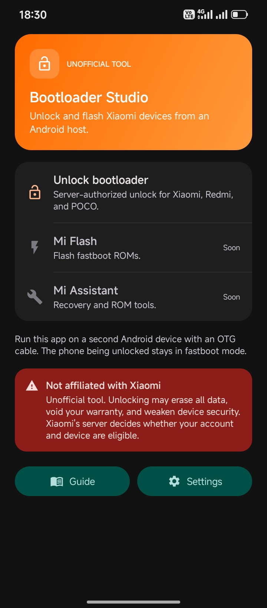
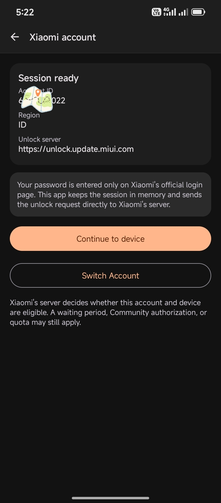
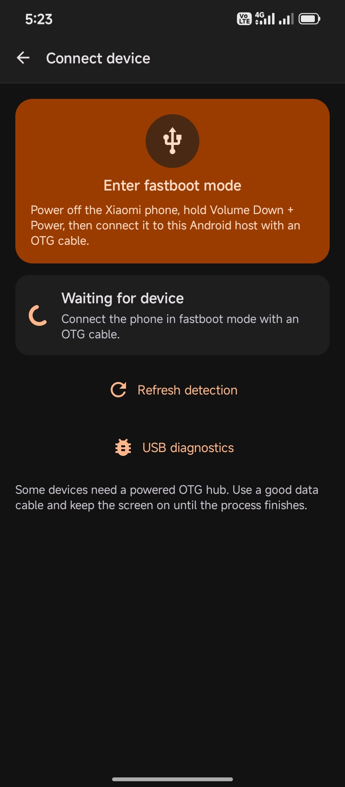

# Bootloader Studio

[](https://github.com/nexarioneo/BootloaderS/actions/workflows/release.yml)
[](LICENSE)
[](https://developer.android.com)
[](https://kotlinlang.org)
[](https://xdaforums.com/t/app-open-source-bootloader-studio-unlock-your-xiaomi-bootloader-from-another-android-phone-no-pc-required.4809795/)
[](https://www.reddit.com/r/PocoPhones/s/hFnUvWBCNK)

Bootloader Studio is an unofficial Android client for **Xiaomi bootloader
unlocking**. It performs the same server-authorized procedure as the official
Windows Mi Unlock tool and stages the signed unlock token over USB fastboot.

> [!IMPORTANT]
> **Not affiliated with Xiaomi.** Xiaomi, Redmi, POCO, MIUI, HyperOS, and Mi
> Unlock are trademarks of Xiaomi Inc. This project is not endorsed by or
> supported by Xiaomi. Use it only on devices you own, at your own risk.

## Screenshots

| Home | Xiaomi account | Connect device |
| :---: | :---: | :---: |
|  |  |  |

## Features

- Xiaomi account login through Xiaomi's own login page in a WebView.
- Region-aware unlock server resolution with cookie aggregation across the
  login redirect chain.
- Reads the fastboot product codename, lock state, and device token.
- Requests a nonce and an eligibility decision from Xiaomi's servers.
- Shows localized official Xiaomi error messages while preserving the raw
  server response.
- Sends the signed `ahaUnlock` request and stages the token with
  `download:<size>` followed by `oem unlock`.
- Verifies the result by re-reading the fastboot lock state.
- Stores the Xiaomi session as an Android Keystore AES/GCM encrypted blob.

## How it works

1. Sign in with an eligible Xiaomi account.
2. Connect the target phone over USB in fastboot mode.
3. The app reads the device identity and requests unlock eligibility.
4. Once Xiaomi approves, the app stages the token and sends `oem unlock`.
5. The app re-reads the lock state and reports the outcome.

The phone being unlocked must be in fastboot mode, so it cannot run the app
itself. A second Android device with USB host/OTG support is required.

## Requirements

- Android 9 (API 28) or newer on the host device.
- USB host / OTG support on the host device.
- A second Android device to unlock, booted into fastboot mode.
- An eligible Xiaomi account bound to the target device.

## Download

Signed APKs are published on the
[Releases](https://github.com/nexarioneo/BootloaderS/releases) page. The
**universal** APK is recommended for sideloading.

## Community

Questions, feedback, and device reports are welcome in the
[XDA Forums thread](https://xdaforums.com/t/app-open-source-bootloader-studio-unlock-your-xiaomi-bootloader-from-another-android-phone-no-pc-required.4809795/)
or on [Reddit r/PocoPhones](https://www.reddit.com/r/PocoPhones/s/hFnUvWBCNK).

## Build

### Prerequisites

- JDK 17 or newer.
- Android SDK with API 36 and build-tools 36.1.0.
- `ANDROID_HOME` set, or `sdk.dir` defined in `local.properties`.

```bash
./gradlew assembleDebug
```

`./gradlew` works on a normal checkout. Use `sh gradlew` when the project lives
on shared storage mounted without execute permission, such as
`/storage/emulated/0` on Android.

The debug APK is written to `app/build/outputs/apk/debug/app-debug.apk`.

### Tests

```bash
./gradlew testDebugUnitTest
```

The unit tests cover request signing and encryption, fastboot packet parsing
and value normalization, hex utilities, localized Xiaomi error-code mapping,
session encoding and migration, unlock result verification, preflight cooldown,
the ViewModel state machine, cookie aggregation across redirects, and the
auth/unlock repositories against MockWebServer.

### Release APKs

```bash
./gradlew assembleRelease
```

Release builds produce one signed APK per ABI plus a universal APK:

| APK | ABI |
| --- | --- |
| `app-armeabi-v7a-release.apk` | 32-bit ARM |
| `app-arm64-v8a-release.apk` | 64-bit ARM |
| `app-x86-release.apk` | 32-bit x86 |
| `app-x86_64-release.apk` | 64-bit x86 |
| `app-universal-release.apk` | all of the above |

Signing reads `RELEASE_STORE_FILE`, `RELEASE_STORE_PASSWORD`,
`RELEASE_KEY_ALIAS`, and `RELEASE_KEY_PASSWORD` from the environment or
`local.properties`. The keystore lives in `keystore/` and is never committed.

### Linux ARM64 hosts

Google's Maven `aapt2` artifact is x86_64-only. On an aarch64 Linux host,
install an aarch64 build of `aapt2` (for example build-tools 36.1.0 from
[android-arm-build-tools](https://github.com/Commit451/android-arm-build-tools),
MIT licensed) and point Gradle at it:

```properties
# ~/.gradle/gradle.properties
android.aapt2FromMavenOverride=/absolute/path/to/aapt2
```

## Continuous integration

The [release workflow](.github/workflows/release.yml) builds signed release
APKs on every push to `main` and every pull request, then uploads them as
workflow artifacts. Pushing a `v*` tag also publishes them to a GitHub Release.

Signing material is supplied through the `KEYSTORE_BASE64`,
`KEYSTORE_PASSWORD`, `KEY_ALIAS`, and `KEY_PASSWORD` repository secrets.

## Architecture

### Login

The login flow is split into a native Material 3 `LoginScreen` and a reusable
Compose `AppWebViewScreen`. The WebView loads Xiaomi's own login page directly;
no credentials are handled by the app. Authorization completion is detected via
the Xiaomi STS end pattern, after which `passToken`, `deviceId`, and `userId`
cookies are captured.

<details>
<summary>WebView implementation notes</summary>

- Uses the default view layer type to avoid blank frames when composited
  inside Compose on MIUI and HyperOS.
- Uses the `(Android) Mobile` user agent. Xiaomi's desktop bundle does not
  serve the mobile login routes, which results in a blank page.
- Disables unnecessary CSS transitions on `onPageFinished` for responsiveness.
- Provides Material 3 loading, error, and success states, with retry and
  open-in-browser fallbacks.

</details>

### Session storage

The Xiaomi session (pass token, device ID, account ID, region and host,
`ssecurity`, service token, and resolution time) is persisted as a single
AES/GCM blob. The key is generated in and never leaves the Android Keystore.
Plaintext sessions from older builds are migrated on first launch and the
legacy keys are removed.

### Unlock verification

- After `oem unlock` returns `OKAY`, the app re-reads `getvar unlocked`. A
  confirmed unlock or a device that rebooted/disconnected is reported as a
  successful request; a device that still reports `locked` is shown as an
  error with on-device confirmation guidance.
- A successful eligibility preflight is reused for the same device for three
  minutes. Errors and device changes force a fresh request.
- Before requesting approval and again before staging the token, the app
  checks the USB handle, product codename, device token, and session device ID.
  A changed handle or token stops the flow instead of unlocking the wrong
  device.
- Fastboot reads use a 5-second default timeout. Transport failures are
  classified as disconnected, timed out, or other, with localized guidance.

## Limitations

- Does not bypass waiting periods, quotas, region checks, Community levels,
  account binding, or any other Xiaomi eligibility rule. Xiaomi's server makes
  the decision and its error details are always preserved.
- Does not retry rejected unlock requests automatically.
- Does not include Xiaomi binaries, ROMs, or proprietary tools.
- The unlock request format includes an HMAC key and a Windows client version
  string taken from the unofficial reference implementation. These constants
  may need updating if Xiaomi changes its client.

## Risk

Unlocking the bootloader usually erases all user data and may void the
warranty. Use this app only on devices you own.

## License

Licensed under the [Apache License 2.0](LICENSE).

## Credits

- [MiTools](https://github.com/MiForge/MiTools) (Apache-2.0) — reference for
  the unlock signing and USB fastboot flow.
- [Material Icons](https://github.com/google/material-design-icons)
  (Apache-2.0) — vector icons used in the app.
